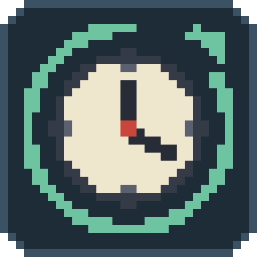
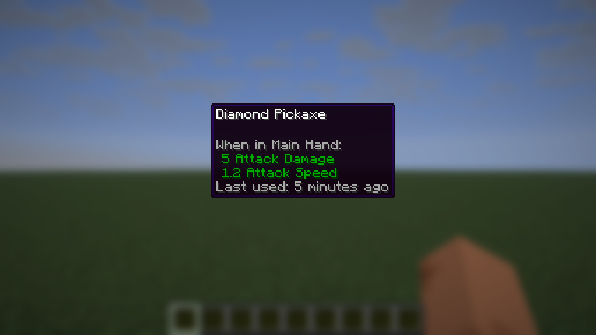
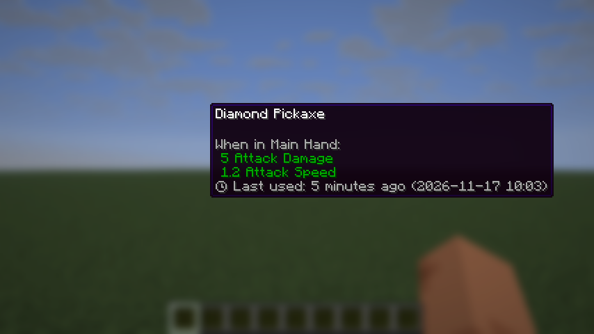
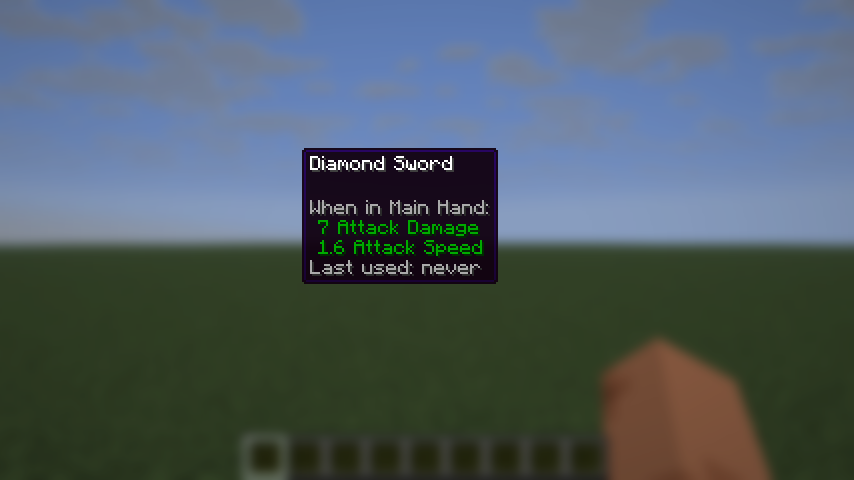

# Last Used

      

**See at a glance when you last used an item.** Hover any tool, weapon, armor piece or other item and its tooltip
shows `Last used: 12 minutes ago` – or `Last used: never`.

> **Based on the concept of [Last Use Tooltip](https://modrinth.com/mod/lastusetooltip) by perusi.
> Independently developed for Minecraft 26.3 Fabric and NeoForge.**
> Last Used is a new implementation and is not affiliated with the original author. See [CREDITS.md](CREDITS.md).

| | |
|---|---|
| Minecraft | 26.3 |
| Loaders | Fabric (with Fabric API) · NeoForge |
| Install on | **client and server** (single player: just your game) |
| Languages | English, German |

## What you see

With the optional clock symbol and absolute time, and a new item:

`just now` · `5 minutes ago` · `2 hours ago` · `3 days ago` · `2 weeks ago` · `never`
(German: `gerade eben` · `vor 5 Minuten` · `vor 2 Stunden` · `vor 3 Tagen` · `Noch nie benutzt`).

The line is gray, sits below the item's own information (above the F3+H debug lines) and leaves all other
tooltip lines untouched. Optional: absolute date/time, second precision, a small clock symbol.

## How tracking works

The **server** records the time whenever a player actually uses an item:

- right-click with the item (bows, shields, food, ender pearls, fishing rods, ...),
- using the item on a block (placing, tilling, stripping, lighting, buckets, composter, jukebox, ...),
- using the item on a mob (name tags, dyes, saddles, ...),
- hitting a mob, breaking a block with a tool,
- durability use: blocked hits on a shield, hits absorbed by armor, elytra flight, shears, flint and steel, ...

Failed or cancelled attempts do **not** count (eating while full, a bow without arrows, an action blocked by
protection or another mod), and neither does opening a chest or door while holding something.

The time is stored on the item itself (a data component with real-world time, not game ticks), so it survives
restarts, chests, hoppers, death, dropping and trading items between players.

### Item stacks

Two stacks with different timestamps can never merge in vanilla Minecraft. To keep your inventory tidy, Last
Used therefore tracks **unstackable items** (tools, weapons, armor, shields, bows, potions, ...) by default and
leaves stackable items (blocks, food, arrows, ...) alone – they show no line at all. Server owners can enable
stackable items in the config, accepting that used and unused stacks then stay separate. Splitting a stack
copies its timestamp; crafting creates a new, never used item; anvils and smithing tables keep the timestamp of
the main item. Details: [ARCHITECTURE.md](ARCHITECTURE.md#4-item-stacks-and-identity).

### Multiplayer

Install Last Used on the server **and** on every client. The server sends one tiny packet at login (which items it
tracks and its clock), so ages are correct even if your PC clock differs from the server's. A client with Last
Used on a server without it shows existing timestamps but never claims "never".

## Configuration

`config/lastused.properties` is created on first start (read once; restart to apply):

| Key | Default | |
|---|---|---|
| `tooltip.enabled` | `true` | show the line |
| `tooltip.show_never` | `true` | show "never" for unused tracked items |
| `tooltip.relative` / `tooltip.absolute` | `true` / `false` | relative age / date and time |
| `tooltip.absolute_pattern` | `yyyy-MM-dd HH:mm` | date pattern |
| `tooltip.seconds` | `false` | "12 seconds ago" instead of "just now" |
| `tooltip.icon` | `false` | small clock symbol |
| `tracking.enabled` | `true` | server: record uses |
| `tracking.stackable_items` | `false` | server: also track stackable items |
| `tracking.update_interval_seconds` | `1` | server: rewrite the same item at most this often |
| `tracking.category.<group>` | `true` | server: `shields`, `ranged`, `consumables`, `weapons`, `armor`, `tools`, `blocks`, `other` |

## Performance

Purely event-based: no inventory scans, no per-tick work (the only tick listener is the boot check, which returns
immediately unless enabled for testing), no background threads, no file access after startup, one packet per login. The age is computed only while a tooltip is visible.

## Documentation

- [ARCHITECTURE.md](ARCHITECTURE.md) – design decisions, hooks, stack rules, client/server
- [CREDITS.md](CREDITS.md) – original concept and author
- [CHANGELOG.md](CHANGELOG.md)
- [LICENSE](LICENSE)

## Links

*   [Wiki](https://github.com/CptGummiball/last-used/wiki)
*   [Supported versions](https://github.com/CptGummiball/last-used/wiki/Supported-Versions)
*   [Report a bug](https://github.com/CptGummiball/last-used/issues/new/choose)
*   [Request a Minecraft version](https://github.com/CptGummiball/last-used/issues/new?template=version_request.yml)
*   [API for mod developers](https://github.com/CptGummiball/last-used/blob/main/api/README.md)
